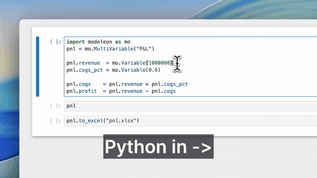
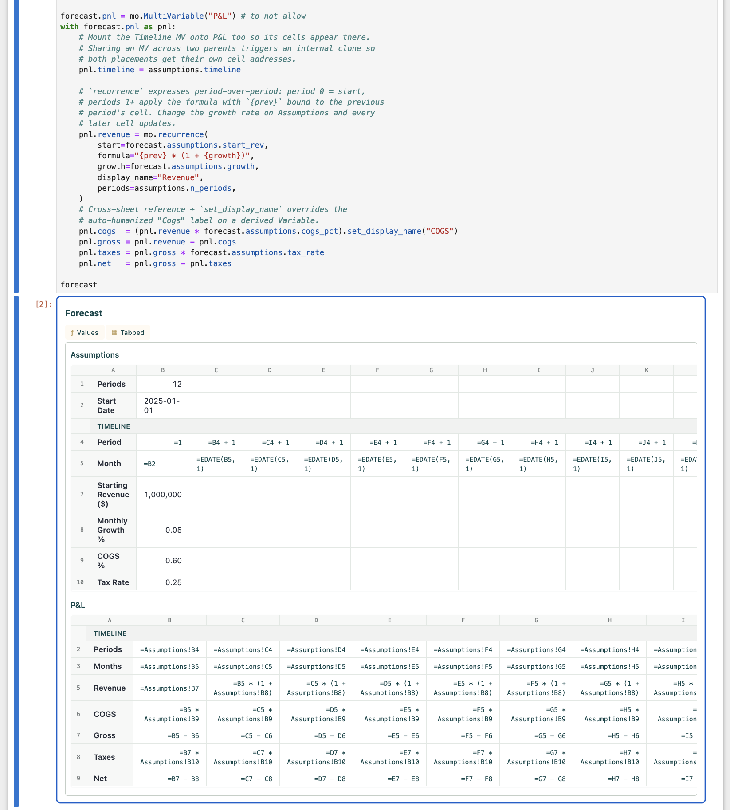

# Modeleon

[](https://pypi.org/project/modeleon/)
[](https://python.org)
[](LICENSE)
[](https://colab.research.google.com/github/modeleonai/modeleon/blob/main/notebooks/01_first_model.ipynb)

**Write Python. Ship real Excel formulas.**

> **Variable** — a value.  
> **MultiVariable** — a concept, modeled as a set of Variables and sub-concepts.  
> **Excel** — one cell-traceable snapshot of a MultiVariable.

<p align="center">
  
</p>

```python
import modeleon as mo

forecast = mo.MultiVariable("Forecast")
forecast.pnl = mo.MultiVariable("P&L")
with forecast.pnl as pnl:
    pnl.revenue  = mo.Variable(1_000_000, unit="$")
    pnl.cogs_pct = mo.Variable(0.6, display_name="COGS %")
    pnl.cogs     = pnl.revenue * pnl.cogs_pct
    pnl.profit   = pnl.revenue - pnl.cogs

forecast.to_excel("forecast.xlsx")
```

The resulting `forecast.xlsx`:

|   | A             | B          |
|---|---------------|------------|
| 1 | Revenue ($)   | `1000000`  |
| 2 | COGS %        | `0.6`      |
| 3 | Cogs          | `=B1*B2`   |
| 4 | Profit        | `=B1-B3`   |

`B3` is `=B1*B2` — a real Excel formula, not the baked value `600000`.

---

## How is this different from openpyxl / xlsxwriter / pandas?

| | Modeleon | openpyxl / xlsxwriter | pandas → Excel |
|---|---|---|---|
| Output is a live model | ✅ formulas | ⚠️ you author them as strings | ❌ values only |
| Cross-cell dependency graph | ✅ tracked automatically | ❌ | ❌ |
| Cross-sheet refs (`=Sheet!Cell`) | ✅ resolved by the engine | ⚠️ manual string concat | ❌ |
| Audit-trail per cell | ✅ every value traces back | ❌ | ❌ |

The lower stack writes spreadsheets. Modeleon writes the **model** that produces a spreadsheet — every cell, every formula, every dependency.

---

## Install

```bash
pip install modeleon
```

Python 3.12+.

---

## Variable

A value or formula. Arithmetic tracks dependencies automatically.

```python
revenue = mo.Variable(1_000_000)
cogs    = revenue * mo.Variable(0.6)
cogs.value         # 600_000.0
cogs.formula       # 'revenue * 0.6'
cogs.dependencies  # {'revenue'}
```

Scalar, list, or unit-bearing — all the same Variable.

---

## MultiVariable

A concept. Variables are its attributes; sub-MultiVariables are its inner concepts.

```python
forecast = mo.MultiVariable("Forecast")
forecast.assumptions = mo.MultiVariable("Assumptions", tax_rate=mo.Variable(0.25))
forecast.pnl = mo.MultiVariable("P&L")
forecast.pnl.revenue = mo.Variable(1_000_000)
forecast.pnl.taxes   = forecast.pnl.revenue * forecast.assumptions.tax_rate
```

> **Cross-sheet refs resolve automatically.**  
> `forecast.pnl.taxes = forecast.pnl.revenue * forecast.assumptions.tax_rate` — the engine emits `=B1 * Assumptions!B2` in Excel. Change the tax rate on Assumptions, P&L recalculates.

Reusable concepts subclass `MultiVariableClass`:

```python
class Cohort(mo.MultiVariableClass):
    def compute(self, start, churn, price):
        self.users   = mo.recurrence(start, "{prev} * (1 - {c})", c=churn)
        self.revenue = self.users * price
```

---

## Recurrence — period-over-period series

`recurrence` builds a list-valued Variable where every period references the previous period via a formula. The Excel output is a chain of cells, not a static list of values.

```python
forecast.assumptions = mo.MultiVariable("Assumptions",
    start_rev=mo.Variable(1_000_000, unit="$"),
    growth=mo.Variable([0.05] * 12),
)

forecast.pnl = mo.MultiVariable("P&L")
forecast.pnl.revenue = mo.recurrence(
    start=forecast.assumptions.start_rev,
    formula="{prev} * (1 + {growth})",
    growth=forecast.assumptions.growth,
)
```

The 12 emitted Excel cells:

```
B1: =Assumptions!B1                          (period 0 = start)
C1: =B1 * (1 + Assumptions!C2)               (compounded period 1)
D1: =C1 * (1 + Assumptions!D2)               ...
... through M1
```

Change a growth value on Assumptions — every later cell recalculates.

---

## Loops — rows that read each other across periods

A debt block is a circle if you read it row by row: interest reads the
balance, the balance reads the sweep, the sweep reads the cash left
after interest. Read period by period it is not — interest reads
*last* period's balance. Put the rows in a loop container and write
them as ordinary rows; there a row may be read before the line that
defines it:

```python
m.debt = mo.MultiVariable("Debt", loop=True)
with m.debt as d:
    d.interest = mo.lag(d.balance, fill=m.inp.opening) * m.inp.rate
    d.pot      = m.inp.cash - d.interest - m.inp.scheduled
    d.sweep    = mo.IF(d.pot > 0, d.pot, 0.0) * m.inp.share
    d.balance  = mo.lag(d.balance, fill=m.inp.opening) - m.inp.scheduled - d.sweep
```

The engine settles the loop when `balance` is assigned. The emitted
cells are the shape a hand-built workbook has always had. The loop
closes through the previous column, so Excel sees no circular reference:

```
Interest  B2: =Inputs!B6 * Inputs!B2       C2: =B5 * Inputs!B2
Balance   B5: =Inputs!B6 - Inputs!C4 - B4   C5: =B5 - Inputs!D4 - C4
```

A cycle that does not pass through `mo.lag` is refused by name — it
would need a fixed point, not an order. So is `SUM`, `MAX` or `MIN` over
one operand of a loop row inside the loop: it reads a whole series. Over
two or more operands they work period by period, inside the loop too: a
per-period floor or cap is `mo.MAX(x, 0)` / `mo.MIN(sweep, balance)`, a
subtotal `mo.SUM(a, b)`, written `=MIN(C2, C3)` / `=SUM(C2, C3)` in every
column. A class is a loop container for every instance with `class
Tranche(mo.MultiVariableClass, loop=True)`.

---

## Excel as a snapshot

`.to_excel()` walks the MultiVariable tree and writes a workbook where every Variable is a cell, every formula is `=A1*B2`, every cross-sheet reference is `=Sheet!Cell`.

Standard library functions emit live formulas, not values:

```python
mo.IRR(cf)       # =IRR(B2:F2, 0.1)
mo.NPV(0.1, cf)  # =NPV(0.1, B2:F2)
mo.SUM(revenue)                 # =SUM(B2:F2) — the total over the periods
mo.SUM(product_a, product_b)    # =SUM(B2, B3) in every period — a subtotal of two lines
mo.IF(rev > 0, rev * 0.25, 0)   # =IF(B1>0, B1*0.25, 0)
mo.CHOOSE(scenario, base, bull) # =CHOOSE(B1, B4, B5) in every period — one scenario cell switches the row
mo.EOMONTH(start, 1)            # =EOMONTH(B1, 1)
mo.IFERROR(cost / units, 0)     # =IFERROR(B7 / B8, 0) in every period — a zero divisor shows 0
mo.SUMIFS(amount, region, "North")  # =SUMIFS(C6:E6, C5:E5, "North")
mo.XLOOKUP(year, years, inflation)  # =_xlfn.XLOOKUP(B4, C2:E2, C3:E3)
mo.PERCENTILE_INC(multiples, 0.25)  # =_xlfn.PERCENTILE.INC(Comps!C3:C9, 0.25) — a field down a table
mo.MEDIAN([p.revenue for p in peers])  # each year: =MEDIAN(Peers!C3:C9), =MEDIAN(Peers!D3:D9), …
```

| Family | Functions |
|---|---|
| Aggregates | `SUM`, `MAX`, `MIN`, `AVERAGE`, `PRODUCT` |
| Conditional aggregates | `SUMIF`, `SUMIFS`, `COUNTIF`, `COUNTIFS`, `AVERAGEIF`, `AVERAGEIFS`, `MAXIFS`, `MINIFS`, `COUNT`, `COUNTA` |
| Logic and errors | `IF`, `IFS`, `SWITCH`, `CHOOSE`, `AND`, `OR`, `NOT`, `XOR`, `IFERROR`, `ISERROR`, `ISNUMBER`, `ISBLANK` |
| Lookup | `XLOOKUP`, `INDEX`, `MATCH`, `VLOOKUP`, `HLOOKUP` |
| Math and rounding | `ABS`, `ROUND`, `ROUNDUP`, `ROUNDDOWN`, `TRUNC`, `INT`, `MOD`, `CEILING`, `FLOOR`, `POWER`, `SQRT`, `EXP`, `LN`, `LOG`, `LOG10`, `SIGN` |
| Financial | `IRR`, `NPV`, `XIRR`, `XNPV`, `PMT`, `FV`, `PV`, `NPER`, `RATE`, `IPMT`, `PPMT`, `CUMIPMT`, `CUMPRINC` |
| Depreciation | `SLN`, `DB`, `DDB`, `SYD` |
| Dates | `DATE`, `YEAR`, `MONTH`, `DAY`, `DAYS`, `DAYS360`, `YEARFRAC`, `DATEDIF`, `EDATE`, `EOMONTH`, `WEEKDAY`, `WEEKNUM`, `NETWORKDAYS`, `WORKDAY`, `TODAY` |
| Text | `LEN`, `UPPER`, `LOWER`, `CONCAT`, `LEFT`, `RIGHT`, `MID`, `TRIM`, `FIND`, `SEARCH`, `SUBSTITUTE`, `VALUE`, `TEXT`, `REPT`, `TEXTJOIN` |
| Statistics | `MEDIAN`, `STDEV_S`, `STDEV_P`, `VAR_S`, `VAR_P`, `PERCENTILE_INC`, `PERCENTILE_EXC`, `QUARTILE_INC`, `QUARTILE_EXC`, `LARGE`, `SMALL`, `RANK_EQ`, `RANK_AVG`, and the older `STDEV`, `STDEVP`, `VAR`, `VARP`, `PERCENTILE`, `QUARTILE`, `RANK` |

All emit live formulas. A function of one value per period, given a row, is one call per period (`=ROUNDUP(C9, 1)`, `=ROUNDUP(D9, 1)`, …) and runs inside a loop container too. A row given where a function takes one value is read per period as well: `mo.ROUND(x, digits)` is `=ROUND(C9, C10)` and `mo.PMT(rate / 100, 12, 1000)` is `=PMT(C9 / 100, 12, 1000, 0, 0)` in each column. Every function reads rows on other time windows by date and rows along keys key by key, as `a + b` reads them (the workbook reads the cell of the same date, and the row's `extend=` rule where it has none); a loop container's rows read them so too. A formula over a row runs on that row's window and, carrying no `extend=` rule, must cover the combined window: `mo.IF(fee > 15, rev, 0)` with `fee` on a tranche's window asks for a line with a rule, `m.t.big = mo.Variable(m.t.fee > 15, extend=mo.zero())`. Every aggregate follows one rule: several series given to it — `SUM`, `AVERAGE`, `MIN`, `MAX`, `PRODUCT`, `COUNT`, `COUNTA`, `MEDIAN`, `STDEV_S`, `STDEV_P`, `VAR_S` or `VAR_P` — or listed as a percentile's or a rank's range, are combined period by period, as `a + b` is (`mo.SUM(a, b)` is `=SUM(C5, C9)` and `mo.MEDIAN(plan, actual)` is `=MEDIAN(C5, C9)` in each column); one row alone is reduced over its periods (`mo.SUM(a)` is `=SUM(C5:N5)`); scalars only stay one number. The total of several rows over all their periods is `mo.SUM(a) + mo.SUM(b)`. A function Excel added after 2007 is stored with the `_xlfn.` prefix the file format expects, and a name Excel spells with a dot is written with an underscore (`mo.PERCENTILE_INC` is `PERCENTILE.INC`).

---

## In a notebook

Every Variable, MultiVariable, and Model has a built-in `_repr_html_`. In Jupyter you see a live grid of values + formulas with click-to-trace-precedents — Excel's "Trace Precedents" button, in the browser. Toggle "Formulas" to flip every cell to its underlying expression.



Try it without installing anything: [Open the first-model notebook in Colab](https://colab.research.google.com/github/modeleonai/modeleon/blob/main/notebooks/01_first_model.ipynb).

---

If Modeleon resonates — a GitHub ⭐ helps more people find it.

---

## License

Apache 2.0. See [LICENSE](LICENSE) and [NOTICE](NOTICE).

**Why this exists →** [The case for Financial Model Engineering](https://modeleon.ai/blog/financial-models-should-be-engineered)

**Releases:** [CHANGELOG](CHANGELOG.md) · [GitHub releases](https://github.com/modeleonai/modeleon/releases)

[modeleon.ai](https://modeleon.ai) · [PyPI](https://pypi.org/project/modeleon/)
